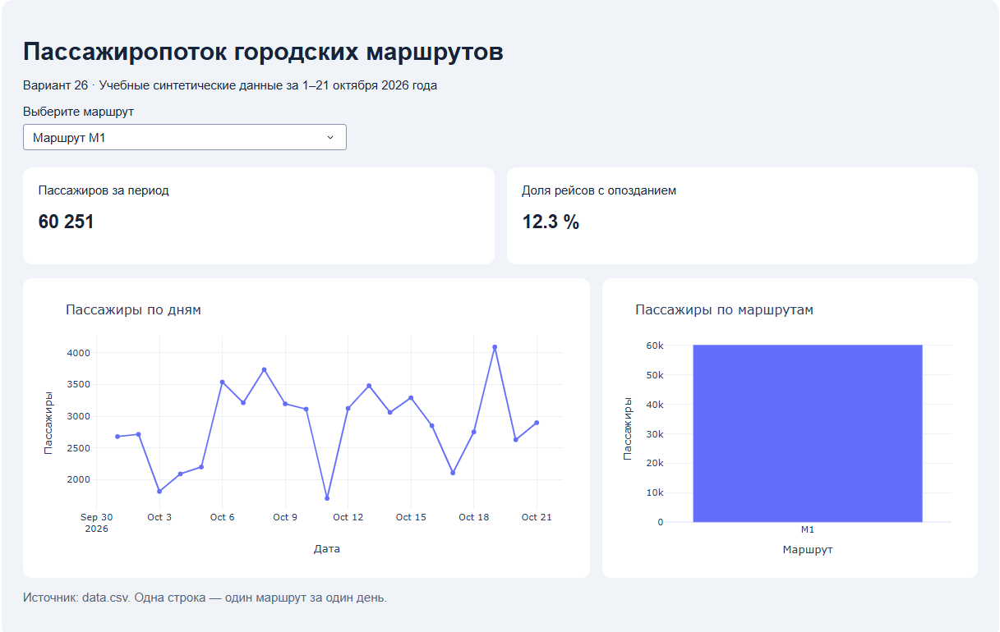

# Анализ пассажиропотока городских маршрутов

Разработайте интерактивный дашборд на Python. Диспетчеру нужно видеть, как меняется пассажиропоток по дням, какой маршрут перевозит больше пассажиров и какая доля рейсов опаздывает.

Разметка страницы и подключение интерактивных элементов уже находятся в `app.py`. Дополните семь блоков с комментариями `# TODO:`, сделайте выводы по своим данным и опубликуйте решение в собственном репозитории GitHub.

На странице должны быть список маршрутов, сумма пассажиров, процент опоздавших рейсов, линия пассажиропотока по дням и столбцы суммарного потока по маршрутам. При выборе M1, M2 или M3 оба показателя и оба графика должны обновляться без перезапуска. Период всегда включает все 21 день из CSV.

## Порядок работы

1. Скачайте файлы и выберите свой набор данных.
2. Создайте окружение, установите библиотеки и запустите приложение.
3. Изучите данные и принцип работы callback.
4. Последовательно выполните TODO 1–7.
5. Проверьте расчеты и переключение маршрутов.
6. Заполните раздел «Результаты анализа» и добавьте скриншот.
7. Загрузите в свой GitHub только решение и выбранный `data.csv`.

## 1. Получение файлов и выбор данных

### Скачайте задание

На странице репозитория преподавателя нажмите **Code → Download ZIP**, распакуйте архив и откройте папку с `app.py`. Не работайте непосредственно внутри архива. Если задание выдано ZIP-файлом, просто распакуйте его.

Исходные файлы:

```text
passenger-dashboard/
├── .gitignore
├── app.py
├── data.csv
├── requirements.txt
├── README.md
└── datasets/
    ├── default.csv
    ├── variant_01.csv
    ├── variant_02.csv
    ├── ...
    └── variant_31.csv
```

Корневой `data.csv` первоначально содержит резервный вариант 00. Если вы есть в списке ниже, замените его своим вариантом.

### Найдите себя в списке

Номер закреплен за студентом. Не выбирайте его по случайному порядку файлов и не меняйте после начала работы.

| Вариант | Студент | Файл в datasets |
|---|---|---|
| 01 | Аниканов Артём Александрович | `variant_01.csv` |
| 02 | Барабанов Максим Михайлович | `variant_02.csv` |
| 03 | Большаков Максим Олегович | `variant_03.csv` |
| 04 | Викентьев Илья Алексеевич | `variant_04.csv` |
| 05 | Гельфер Даниил Алексеевич | `variant_05.csv` |
| 06 | Гласинскас Кирилл Евгеньевич | `variant_06.csv` |
| 07 | Гранина Вероника Андреевна | `variant_07.csv` |
| 08 | Гридин Харитон Геннадьевич | `variant_08.csv` |
| 09 | Громаков Артём Денисович | `variant_09.csv` |
| 10 | Дрожжин Денис Дмитриевич | `variant_10.csv` |
| 11 | Зарубин Федор Алексеевич | `variant_11.csv` |
| 12 | Иванов Ростислав Николаевич | `variant_12.csv` |
| 13 | Ильюк Мария | `variant_13.csv` |
| 14 | Казанцева Полина Сергеевна | `variant_14.csv` |
| 15 | Камашин Петр Александрович | `variant_15.csv` |
| 16 | Клименко Кирилл Сергеевич | `variant_16.csv` |
| 17 | Колосов Иван Вячеславович | `variant_17.csv` |
| 18 | Королев Артём Игоревич | `variant_18.csv` |
| 19 | Котова Анастасия Сергеевна | `variant_19.csv` |
| 20 | Кошкин Артём Викторович | `variant_20.csv` |
| 21 | Кузин Станислав Андреевич | `variant_21.csv` |
| 22 | Кузнецов Кирилл Игоревич | `variant_22.csv` |
| 23 | Курков Владислав Алексеевич | `variant_23.csv` |
| 24 | Кушнеров Даниил Валентинович | `variant_24.csv` |
| 25 | Ляшенко Михаил Сергеевич | `variant_25.csv` |
| 26 | Осипова Вероника Романовна | `variant_26.csv` |
| 27 | Пустовойт Варвара Алексеевна | `variant_27.csv` |
| 28 | Сбродов Арсений Андреевич | `variant_28.csv` |
| 29 | Титкин Арсений Алексеевич | `variant_29.csv` |
| 30 | Ткачева Дарья Андреевна | `variant_30.csv` |
| 31 | Яковлев Матвей Дмитриевич | `variant_31.csv` |

### Скопируйте свой файл

1. Найдите свой CSV в `datasets`.
2. Скопируйте его в папку с `app.py`, переименовав копию в **`data.csv`**. Подтвердите замену существующего файла.
3. Откройте `data.csv` в редакторе. Значение столбца `variant` должно совпадать с вашим номером во всех строках.
4. **Удалите папку `datasets` из своей распакованной рабочей копии** через проводник или файловый менеджер. В решении должен остаться один CSV — корневой `data.csv`.

Например, для варианта 07 копирование можно выполнить командой из папки проекта. Выполните только команду для своего терминала и замените `07` своим двузначным номером.

Windows PowerShell:

```powershell
Copy-Item -LiteralPath .\datasets\variant_07.csv -Destination .\data.csv -Force
```

Windows cmd:

```bat
copy /Y datasets\variant_07.csv data.csv
```

macOS / Linux:

```bash
cp datasets/variant_07.csv data.csv
```

После копирования удалите только папку `datasets`, не корневой `data.csv`. Не изменяйте числа, заголовки и строки выбранного файла. В приложении используется имя `data.csv`, независимо от исходного имени варианта.

### Если вас нет в списке

Используйте **`datasets/default.csv` — резервный вариант 00**. Не берите вариант другого студента и не назначайте себе новый номер.

Скопируйте `default.csv` в корень как `data.csv`, затем удалите `datasets`. В PowerShell:

```powershell
Copy-Item -LiteralPath .\datasets\default.csv -Destination .\data.csv -Force
```

В cmd: `copy /Y datasets\default.csv data.csv`. На macOS/Linux: `cp datasets/default.csv data.csv`.

В столбце `variant` будет `0`, в интерфейсе — `00`. В разделе «Результаты анализа» укажите свое имя и напишите: **«В списке не найден(а), использован резервный вариант 00 — default.csv»**. Далее выполняйте то же задание. Если отсутствующих в списке несколько, они используют этот же резервный набор.

## 2. Окружение и установка библиотек

Нужны Python 3.12, редактор кода, браузер и Git. Для публикации нужен свой аккаунт GitHub. Откройте терминал в папке с `app.py`. Для перехода в другую папку используйте `cd "ПУТЬ_К_ПАПКЕ_ПРОЕКТА"`, подставив реальный путь. В Windows cmd для перехода также на другой диск используйте `cd /d "ПУТЬ_К_ПАПКЕ_ПРОЕКТА"`.

Виртуальное окружение — отдельная папка с Python и библиотеками данного проекта. Ее не загружают в GitHub: на другом компьютере окружение создают заново по `requirements.txt`.

`requirements.txt` содержит `dash`, `pandas`, `plotly` без закрепленных версий и условий для конкретного Python. Сохраните этот файл. Pip устанавливает совместимые с вашим Python версии библиотек; на занятии используем 3.12.

### Windows: PowerShell

```powershell
py -3.12 --version
py -3.12 -m venv .venv
.\.venv\Scripts\Activate.ps1
python -m pip install -r requirements.txt
```

Если `py` не найден, проверьте `python --version`. Если это Python 3.12, для создания окружения используйте `python -m venv .venv`.

Если PowerShell запрещает запуск `Activate.ps1`, активация не обязательна. После создания окружения установите библиотеки его Python напрямую:

```powershell
.\.venv\Scripts\python.exe -m pip install -r requirements.txt
```

### Windows: командная строка cmd

```bat
py -3.12 -m venv .venv
.venv\Scripts\activate.bat
python -m pip install -r requirements.txt
```

Без активации: `.venv\Scripts\python.exe -m pip install -r requirements.txt`.

### macOS / Linux: bash или zsh

```bash
python3 --version
python3 -m venv .venv
source .venv/bin/activate
python -m pip install -r requirements.txt
```

При нескольких установленных версиях можно явно использовать `python3.12 -m venv .venv`. При ошибке об отсутствии `venv` на Debian/Ubuntu установите пакет для своей версии Python: обычно `sudo apt install python3-venv`, а для отдельно установленного Python 3.12 — `sudo apt install python3.12-venv`. Затем повторите создание окружения.

Без активации: `.venv/bin/python -m pip install -r requirements.txt`.

Далее команды `python ...` предполагают активированное окружение. Без активации заменяйте `python` на `.\.venv\Scripts\python.exe` в PowerShell, `.venv\Scripts\python.exe` в cmd или `.venv/bin/python` на macOS/Linux.

## 3. Первый запуск

В активированном окружении выполните:

```bash
python app.py
```

Например, без активации в PowerShell: `.\.venv\Scripts\python.exe app.py`.

Откройте [http://127.0.0.1:8050](http://127.0.0.1:8050) в браузере. Исходное приложение показывает пустые графики с пояснениями: чтение данных и расчеты предстоит дописать.

Сохраняйте `app.py` после правки. Режим `debug=True` перезагружает приложение; при необходимости обновите страницу. Остановка сервера — `Ctrl+C` в терминале. Не запускайте вторую копию на том же порту. Для выхода из активированного окружения выполните `deactivate`.

## 4. Данные и устройство приложения

### Что означает строка CSV

В файле 63 строки: три маршрута за 21 день, с 1 по 21 октября 2026 года. Одна строка — один маршрут за один день. Данные учебные, синтетические; они не описывают реального перевозчика. Кодировка UTF-8, разделитель — запятая, первая строка содержит заголовки.

| Столбец | Значение |
|---|---|
| `variant` | Номер набора данных; во всех строках одинаковый |
| `date` | Дата в формате `YYYY-MM-DD` |
| `route` | Маршрут M1, M2 или M3 |
| `passengers` | Количество пассажиров за день |
| `trips` | Количество выполненных рейсов за день |
| `delayed_trips` | Сколько из этих рейсов опоздали |

Числовые показатели целые, `trips` положителен, `delayed_trips` находится от 0 до `trips` включительно. Пропусков в исходных данных нет.

### pandas: таблица, столбец и фильтр

`pandas` читает CSV в `DataFrame` — таблицу с именованными столбцами. Вся таблица в проекте называется `df`. Выражение `df["route"]` выбирает столбец, `.unique()` возвращает неповторяющиеся значения, а `.sum()` складывает значения числового столбца.

Условия можно применять сразу ко всем строкам. Пример для другой задачи:

```python
selected = sales[sales["shop"] == shop_name].copy()
```

`==` сравнивает значения, а `=` присваивает результат переменной. Условие внутри скобок формирует значения `True`/`False`; внешние скобки оставляют строки с `True`. Метод `.copy()` создает отдельную таблицу.

### Группировка

Перед построением графика записи с одной датой нужно объединить. Пример группировки для другой задачи:

```python
totals = sales.groupby("shop", as_index=False)["amount"].sum()
```

`groupby` собирает строки по магазину, `["amount"]` указывает суммируемый столбец, `.sum()` считает сумму внутри группы. `as_index=False` сохраняет группировочный столбец обычным столбцом результата. `.sort_values("имя_столбца")` сортирует таблицу.

В задании группировка нужна по датам и по маршрутам. В режиме «Все маршруты» линейный график должен содержать одну суммарную линию с 21 значением, а не 63 исходные строки.

### Доля рейсов с опозданием

```text
доля опозданий, % = 100 × сумма delayed_trips / сумма trips
```

Не усредняйте дневные проценты. Например, в первый день опоздал 1 рейс из 2, во второй — 1 из 8. За два дня это 2 рейса из 10, то есть 20 %. Среднее дневных процентов 50 % и 12,5 % равно 31,25 % и не соответствует доле опозданий за весь период.

### Plotly: графики

`plotly.express` импортирован как `px`. `px.line` строит линию, `px.bar` — столбцы. Передайте таблицу первым аргументом, названия столбцов — через `x` и `y`, заголовок — через `title`, подписи осей — через `labels`. Пример для другой задачи:

```python
figure = px.bar(
    totals,
    x="shop",
    y="amount",
    title="Выручка по магазинам",
    labels={"shop": "Магазин", "amount": "Выручка"},
)
```

### Dash: разметка и callback

`app.layout` описывает страницу. `dcc.Dropdown` — список выбора маршрута, `dcc.Graph` — область графика. Компоненты имеют идентификаторы `id`.

В готовом `@app.callback(...)`:

- `Input("route-filter", "value")` передает выбранное значение в аргумент `selected_route`;
- два `Output(..., "children")` обновляют тексты показателей;
- два `Output(..., "figure")` обновляют графики.

Dash вызывает `update_dashboard(selected_route)` при открытии страницы и при изменении выбора. Функция возвращает четыре результата в порядке `Output`: пассажиры, процент опозданий, линейный график, столбчатый график.

`"all"` означает «Все маршруты»; другие значения — `"M1"`, `"M2"`, `"M3"`. Вся таблица `df` и выбранные строки `filtered` хранятся отдельно. Не перезаписывайте глобальную `df` ее частью: иначе при возврате к «Все маршруты» исходные данные потеряются.

## 5. Выполнение TODO в app.py

Выполняйте блоки по порядку. После каждого шага сохраняйте файл и проверяйте результат в браузере.

Заменяйте заглушки, а не дописывайте решение перед ними: оставшееся ниже `= 0` или `= []` затрет результат. Сохраните имена переменных, идентификаторы компонентов, декоратор callback и порядок `return`. Функцию `empty_figure` и оформление страницы менять не требуется.

### TODO 1. Прочитать CSV

**Где:** присваивание `df` в начале файла.

Замените создание пустого `DataFrame` вызовом `pd.read_csv`. Передайте `DATA_PATH` и `parse_dates=["date"]`. `DATA_PATH` уже указывает на корневой `data.csv`; путь к `datasets` не нужен. `parse_dates` превращает столбец даты в тип для сортировки и временной оси.

**Проверка:** в подписи страницы появляется ваш номер варианта. Другие элементы пока могут оставаться нулевыми или пустыми.

### TODO 2. Получить маршруты

**Где:** присваивание `route_names`.

Получите уникальные значения `df["route"]` через `.unique()` и отсортируйте их функцией `sorted(...)`. Замените пустой список.

**Проверка:** в списке есть M1, M2, M3 и уже добавленный в разметку пункт «Все маршруты». Повторно добавлять его не нужно.

### TODO 3. Отобрать строки маршрута

**Где:** вместо `pass` внутри `if selected_route != "all":`.

Присвойте `filtered` строки `df`, где `route` равен `selected_route`. Используйте булев фильтр и `.copy()` по примеру из раздела о pandas. Для `"all"` уже оставлена копия всех строк. Строка внутри `if` должна иметь дополнительный отступ из четырех пробелов.

**Проверка:** для одного маршрута в `filtered` 21 строка, для всех — 63. Визуально действие фильтра станет заметно после следующих TODO.

### TODO 4. Посчитать пассажиров

**Где:** присваивание `passenger_total`.

Замените `0` суммой столбца `passengers` в **`filtered`**. Используйте `.sum()`.

**Проверка:** карточка количества пассажиров показывает число и меняется при выборе маршрута.

### TODO 5. Рассчитать долю опозданий

**Где:** присваивание `delay_rate`.

Замените `0.0` отношением суммы `delayed_trips` к сумме `trips`, умноженным на 100. Обе суммы берите из `filtered`. Сохраните число: добавление знака процента и округление до одного знака уже выполняются в `return`. Сумма рейсов в исходных данных положительна.

**Проверка:** процент соответствует выбранным строкам; это доля рейсов, а не пассажиров или дней.

### TODO 6. Построить линию по дням

**Где:** присваивания `daily` и `line`.

1. Сгруппируйте `filtered` по `date` с `as_index=False`.
2. Выберите `passengers` и сложите его значения в каждой группе.
3. Отсортируйте результат по `date` и сохраните в `daily`.
4. Создайте `px.line` по `daily`: `x="date"`, `y="passengers"`.
5. Задайте заголовок «Пассажиры по дням» и русские подписи осей через `labels`. Добавьте `markers=True`, чтобы видеть отдельные точки.

**Проверка:** одна линия с 21 дневным значением. Для «Все маршруты» каждая точка — сумма трех маршрутов за соответствующую дату. Не рисуйте линию по несгруппированным 63 строкам.

### TODO 7. Построить столбцы по маршрутам

**Где:** присваивания `by_route` и `bar`.

1. Сгруппируйте **`filtered`**, а не `df`, по `route` с `as_index=False`.
2. Сложите `passengers` по группам и сохраните в `by_route`.
3. Создайте `px.bar` по `by_route`: `x="route"`, `y="passengers"`.
4. Добавьте заголовок «Пассажиры по маршрутам» и русские подписи осей.

**Проверка:** три столбца для всех маршрутов и один для отдельного. Высота столбца — сумма пассажиров за весь период, а не среднее за день.

## 6. Проверка приложения

Откройте «Все маршруты», затем M1, M2, M3 и снова «Все маршруты». Убедитесь, что:

- номер варианта соответствует CSV;
- оба показателя и оба графика обновляются;
- при возврате к «Все маршруты» восстанавливаются исходные значения;
- на линии 21 дневное значение, даты идут по возрастанию;
- столбцов три для всех маршрутов и один для выбранного;
- сумма столбцов и сумма дневных значений линии равны карточке пассажиров;
- процент находится между 0 и 100 и рассчитан отношением сумм;
- заголовки и подписи читаются, сообщений об ошибках callback нет.

При наведении на точку или столбец Plotly показывает значение. Эти подсказки помогут подготовить выводы.

## 7. Выводы и скриншот

Заполните раздел «Результаты анализа» в конце README: имя, номер варианта и источник, например `datasets/variant_07.csv → data.csv`. Если вас нет в списке, используйте формулировку про резервный вариант из раздела 1.

В режиме **«Все маршруты»** ответьте на два вопроса:

1. Какой маршрут перевез больше всего пассажиров за весь период? Укажите маршрут и число пассажиров.
2. В какой день суммарный пассажиропоток был максимальным? Укажите дату и число пассажиров.

При одинаковых максимумах достаточно указать один из них.

Затем выберите **M2** и сделайте скриншот страницы браузера. На изображении должны читаться номер варианта, M2, оба показателя и оба графика. При необходимости уменьшите масштаб браузера. Сохраните **`screenshot.png`** рядом с `app.py`.

В разделе «Результаты анализа» замените строку-заглушку для изображения на:

```markdown

```

Конструкция `` показывает изображение из репозитория. Имя должно совпадать с файлом, включая регистр. Сохраните изображение именно в PNG: одной замены расширения JPEG на PNG недостаточно.

## 8. Публикация решения в GitHub

В папке решения должны быть шесть файлов:

```text
passenger-dashboard/
├── .gitignore
├── app.py
├── data.csv
├── requirements.txt
├── README.md
└── screenshot.png
```

`.venv` может оставаться локально, но не загружается в GitHub. Папку `datasets`, другие CSV и исходный ZIP в решение не включайте. Единственный CSV — ваш `data.csv` или резервный вариант 00.

### Создайте пустой репозиторий в своем аккаунте

1. Войдите в [GitHub](https://github.com), нажмите **+ → New repository**.
2. Задайте имя, например `passenger-dashboard`.
3. Выберите видимость по требованиям преподавателя; для закрытого репозитория предоставьте ему доступ.
4. **Не добавляйте** через форму README, `.gitignore` и лицензию: локальные файлы уже подготовлены, удаленный репозиторий должен быть пустым.
5. Нажмите **Create repository** и скопируйте HTTPS-адрес вида `https://github.com/USERNAME/passenger-dashboard.git`.

### Подготовьте локальный репозиторий

В терминале папки решения выполните:

```bash
git --version
git init
git branch -M main
```

Если Git просит указать автора, настройте его для этого репозитория, подставив свои данные:

```bash
git config user.name "Имя Фамилия"
git config user.email "ВАША_ПОЧТА"
```

Адрес для коммитов можно посмотреть в **GitHub → Settings → Emails**, в том числе использовать указанный там адрес `noreply` своего аккаунта.

Добавьте **только** файлы решения:

```bash
git add .gitignore app.py data.csv requirements.txt README.md screenshot.png
git diff --cached --name-only
```

Проверьте, что в списке именно эти шесть файлов. Пока других CSV, `datasets` или `.venv` в списке нет, можно продолжать. Если они добавлены по ошибке до первого коммита, уберите их только из индекса: `git rm --cached ПУТЬ_К_ФАЙЛУ`, для папки — `git rm -r --cached ПУТЬ_К_ПАПКЕ`. Подставьте путь к лишнему файлу или папке. С параметром `--cached` файлы остаются на диске. Повторите проверку списка.

Сохраните локальный коммит:

```bash
git commit -m "Add passenger dashboard"
```

Подключите адрес **своего** пустого репозитория и отправьте файлы:

```bash
git remote add origin https://github.com/USERNAME/passenger-dashboard.git
git push -u origin main
```

Замените `USERNAME` и имя репозитория своими. Git может открыть авторизацию в браузере — войдите в свой аккаунт. Обычный пароль аккаунта не используется как пароль для Git по HTTPS; если запрашивается токен, используйте настроенный менеджер учетных данных или [инструкцию GitHub по авторизации](https://docs.github.com/en/authentication/keeping-your-account-and-data-secure/about-authentication-to-github).

`git add` выбирает файлы, `git commit` сохраняет их локально, `git push` отправляет коммиты в GitHub. Одного `git commit` для сдачи недостаточно.

### Если вы ранее клонировали репозиторий преподавателя

Создайте **новую пустую локальную папку**, скопируйте туда только шесть файлов решения и выполните команды публикации в ней. Не копируйте `.git`, `.venv` и `datasets`. Так в вашем репозитории будет только решение с выбранным CSV, без истории шаблона со всеми вариантами. Для запуска в новой папке заново создайте окружение по разделу 2.

### Проверьте страницу на GitHub

- `app.py` содержит решение, `data.csv` — нужный вариант.
- Нет `datasets`, других наборов данных, `.venv` и ZIP-архивов.
- README содержит имя, вариант и оба вывода с числами.
- Скриншот показывается непосредственно в README.
- Последний коммит содержит актуальные изменения.

Для последующих исправлений:

```bash
git add app.py data.csv README.md screenshot.png
git commit -m "Update dashboard"
git push
```

Передайте преподавателю ссылку вида `https://github.com/USERNAME/passenger-dashboard`. Публикация кода не запускает Dash автоматически: приложение скачивают и запускают по командам из README. Отдельный хостинг не требуется.

## Если возникла ошибка

| Ситуация | Что проверить |
|---|---|
| `ModuleNotFoundError` | Устанавливайте зависимости и запускайте приложение одним Python из `.venv`; попробуйте команды без активации |
| `FileNotFoundError` | `data.csv` должен лежать рядом с `app.py`; проверьте, нет ли имени `data.csv.csv` |
| `KeyError` | Имена столбцов должны точно соответствовать CSV |
| Ошибка отступов | Сохраняйте дополнительный отступ внутри `if`, используйте пробелы |
| Фильтр не меняет графики | Считайте и группируйте по `filtered`, а не `df` |
| После возврата виден один маршрут | Не перезаписывайте глобальную `df` отфильтрованными строками |
| Порт 8050 занят | Остановите старый запуск через `Ctrl+C` |
| `git` не найден | Установите Git и заново откройте терминал |
| `origin already exists` | Проверьте `git remote -v`; в папке своего решения адрес заменяется через `git remote set-url origin ВАШ_HTTPS_АДРЕС` |
| `Repository not found` | Проверьте владельца, имя репозитория и доступ аккаунта |
| `push` отклонен из-за непустого репозитория | Для только что созданного репозитория без нужных работ можно создать другой пустой репозиторий и заменить `origin`; не отправляйте изменения принудительно поверх чужой работы |

## Справка

- [Чтение CSV в pandas](https://pandas.pydata.org/docs/reference/api/pandas.read_csv.html)
- [Группировка в pandas](https://pandas.pydata.org/docs/reference/api/pandas.DataFrame.groupby.html)
- [Минимальное приложение Dash](https://dash.plotly.com/minimal-app)
- [Callback в Dash](https://dash.plotly.com/basic-callbacks)
- [Линейные графики Plotly](https://plotly.com/python/line-charts/)
- [Столбчатые графики Plotly](https://plotly.com/python/bar-charts/)
- [Загрузка локального проекта в GitHub](https://docs.github.com/en/migrations/importing-source-code/using-the-command-line-to-import-source-code/adding-locally-hosted-code-to-github)

## Результаты анализа

Имя и фамилия: Вероника Осипова.

Вариант: 26.

Исходный файл: datasets/variant_26.csv скопирован как data.csv

1. Самый загруженный маршрут за весь период: M1, 60 251 пассажиров.
2. Максимальный суммарный пассажиропоток за день: 19 октября 2026, 9611 пассажиров.

